# HCMS (Hydrogen CMS) storefront

<!-- shared:intro -->
This is a Shopify Hydrogen storefront that you edit in the **HCMS** app. HCMS gives
a headless store the theme editor you know from the Online Store: templates, sections, blocks,
theme settings, pages, menus, SEO and versions.

You deploy this storefront to Shopify Oxygen **once**. After that, everything you change in the
HCMS theme editor goes live when you publish. You don't edit code and you don't redeploy.
<!-- /shared:intro -->

- [Install HCMS](#install-hcms)
- [Deploy on Oxygen](#deploy-on-oxygen)
- [Pick a starting theme](#pick-a-starting-theme)
- [Starting themes](#starting-themes)
- [Local development](#local-development)
- [Update the storefront](#update-the-storefront)
- [Custom sections](#custom-sections)
- [Custom CSS](#custom-css)
- [Troubleshooting](#troubleshooting)

<!-- shared:setup -->
## Install HCMS

1. Install the **HCMS: Hydrogen CMS** app from the Shopify App Store.
2. In HCMS, open the **Setup guide** on Home. It has four steps: **Choose a plan**,
   **Connect your storefront**, **Pick a starting theme** and **Go live on your domain**. One step
   is open at a time, and a done step shows a one-line summary.

   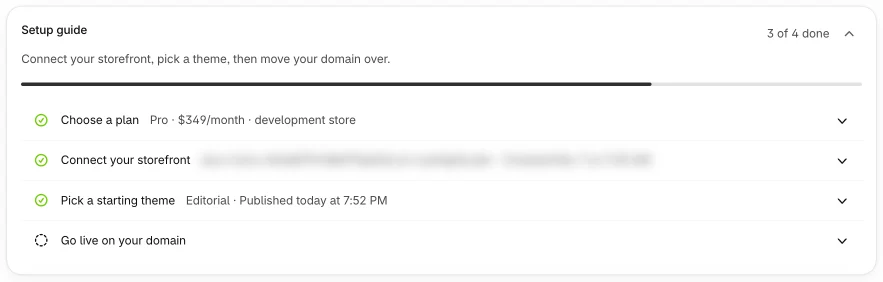

3. **Choose a plan.** Select **Choose a plan** to open the Plan page (also in **Settings › Plan**).
   Every plan starts with a free trial, billed by Shopify. You can change plans any time.

   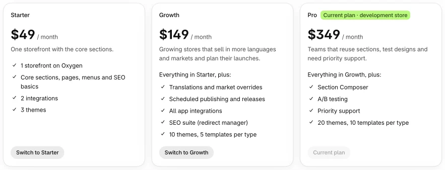

4. **Connect your storefront.** The step has three parts: **Create your storefront from our
   template**, **Add these variables to Production, then redeploy**, and **Tell us where it runs**.
   Follow [Deploy on Oxygen](#deploy-on-oxygen) below; the Setup guide shows the same steps, with
   the values you need and a copy button for each.

## Deploy on Oxygen

1. **Use this template.** At the top of this repository on GitHub, choose **Use this template ›
   Create a new repository**. Pick an owner and a name (for example `my-store-storefront`). It
   can be private or public.
2. **Create a Hydrogen storefront.** In your Shopify admin, go to **Hydrogen › Create
   storefront**. Choose **Set up GitHub continuous deployment**, connect GitHub and pick the
   repository you just created.
3. **Merge Shopify's pull request.** Shopify opens a pull request in your repository. Merge it,
   then wait for the production deployment to finish.
4. **Add the HCMS variables.** In Shopify, go to **Hydrogen › your storefront ›
   Storefront settings › Environments and variables** and add these to **Production**:

   | Variable | What it does |
   | --- | --- |
   | `HCMS_API_URL` | The HCMS address your storefront reads from and sends forms to. |
   | `HCMS_PREVIEW_SECRET` | Signs editor previews and form submissions. Keep it secret. |
   | `HCMS_PUBLIC_KEY` | Lets the storefront read your published theme. |

   Copy the values from the Setup guide (**Connect your storefront**; once it's connected, open
   **Show environment variables**) or from **Settings › Developers › Environment variables** in
   HCMS. Secret values stay hidden until you show or copy them, and only HCMS admins
   can see them.

   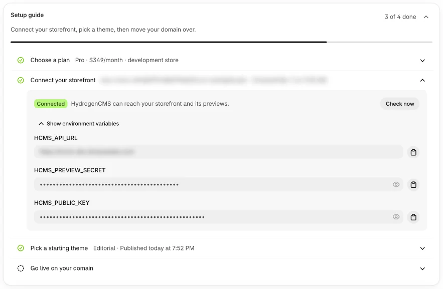

   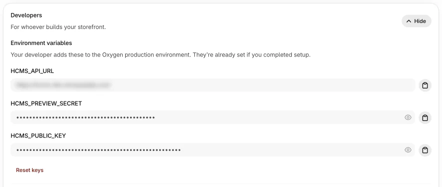

5. **Redeploy.** Variables apply only to new deployments. In Hydrogen, redeploy the latest
   production deployment (or push any commit).
6. **Check the connection.** Back in the Setup guide, under **Tell us where it runs**, paste your
   storefront's **Production URL** (for example `https://your-storefront.o2.myshopify.dev`) and
   select **Check connection**. If your environment is private, select **Open and verify**, then
   **Refresh**. When the step shows **Connected**, use **Check now** any time to check again.

   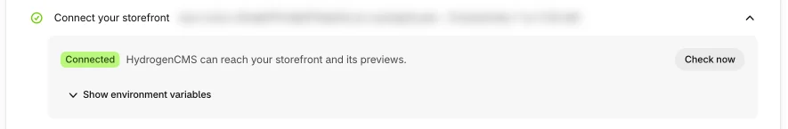

Until the variables are added, every page of the storefront shows a **This storefront runs on
HCMS** setup screen that lists the missing variables (names only, never values). It goes
away after you add them and redeploy. `/__hcms/health` keeps answering, so **Check connection**
can tell you what's missing.

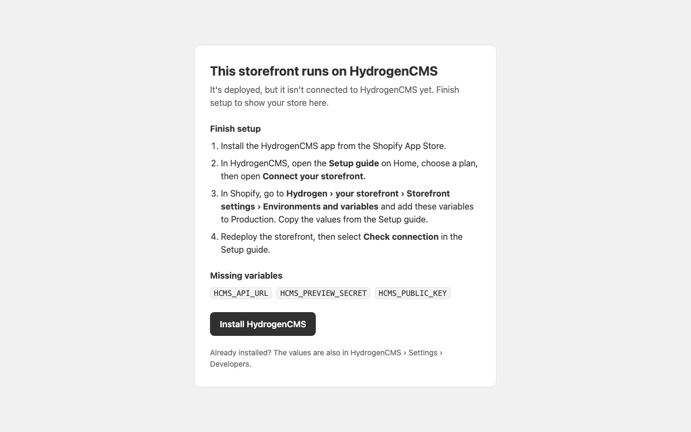

Shopify adds the store variables (`PUBLIC_STORE_DOMAIN`, `PUBLIC_STOREFRONT_ID`,
`PRIVATE_STOREFRONT_API_TOKEN`, and the Customer Account variables) for you when you create the
storefront. Don't copy them by hand.

## Pick a starting theme

1. In the Setup guide, open **Pick a starting theme** and choose how to start: **Start from a
   theme** (one of the [starting themes](#starting-themes), with desktop and phone previews) or
   **Bring your Online Store theme** (upload your theme file; HCMS carries over layout,
   content and settings). Later you can add more from **Themes › Explore all themes**.

   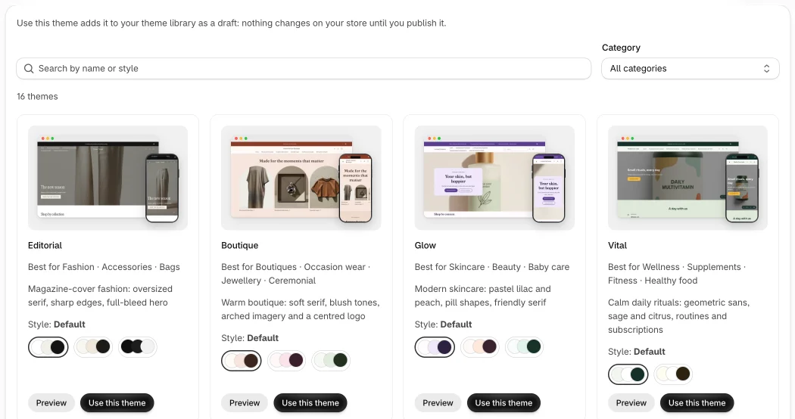

2. **Customize.** Your theme opens in the HCMS theme editor, full screen, like the Online
   Store editor: sections and blocks on the left, a live preview of your storefront on the right.
   Changes save automatically but stay private until you select **Publish**. You can always open
   it again from **Themes › Customize**.

   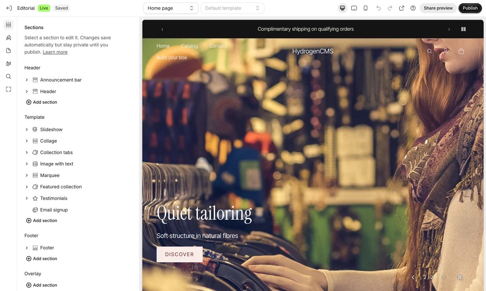

3. **Go live on your domain.** The last Setup guide step opens a checklist that points your
   domain at the new storefront and checks each step for you.

## Starting themes

Every starting theme comes with colour styles and works with every section. Pick one in
**Pick a starting theme** or **Themes › Explore all themes**, then make it yours in the theme editor.

<table>
  <tr>
    <td width="25%" valign="top">
      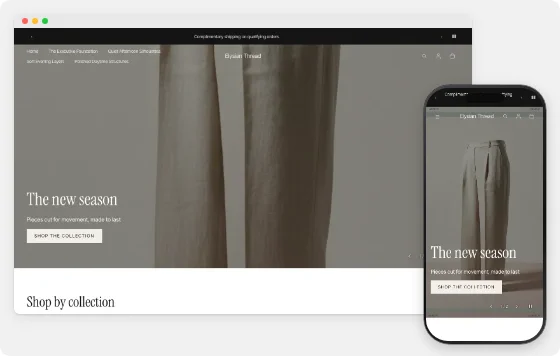
      <br><strong>Editorial</strong>
      <br><sub>Best for Fashion · Accessories · Bags</sub>
    </td>
    <td width="25%" valign="top">
      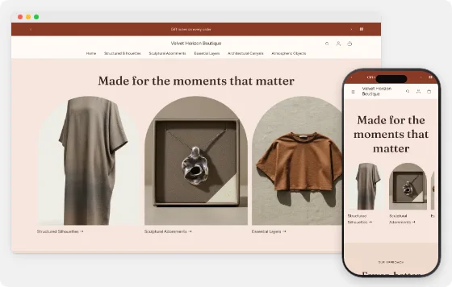
      <br><strong>Boutique</strong>
      <br><sub>Best for Boutiques · Occasion wear · Jewellery · Ceremonial</sub>
    </td>
    <td width="25%" valign="top">
      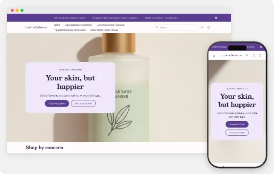
      <br><strong>Glow</strong>
      <br><sub>Best for Skincare · Beauty · Baby care</sub>
    </td>
    <td width="25%" valign="top">
      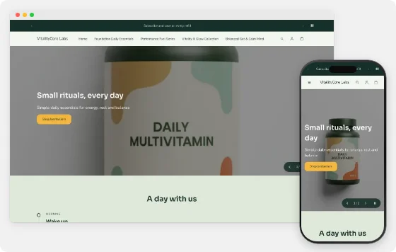
      <br><strong>Vital</strong>
      <br><sub>Best for Wellness · Supplements · Fitness · Healthy food</sub>
    </td>
  </tr>
  <tr>
    <td width="25%" valign="top">
      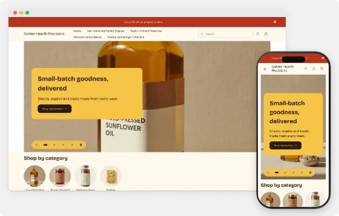
      <br><strong>Market</strong>
      <br><sub>Best for Food · Snacks · Pet food</sub>
    </td>
    <td width="25%" valign="top">
      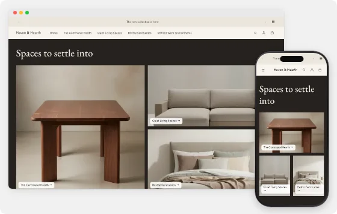
      <br><strong>Nest</strong>
      <br><sub>Best for Furniture · Home décor · Garden</sub>
    </td>
    <td width="25%" valign="top">
      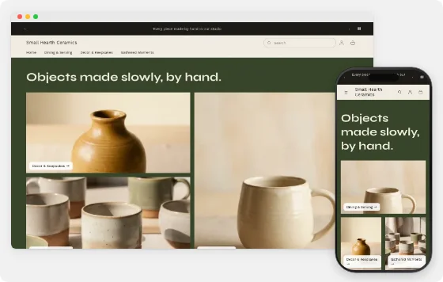
      <br><strong>Atelier</strong>
      <br><sub>Best for Handmade · Art &amp; prints · Tools · Home goods</sub>
    </td>
    <td width="25%" valign="top">
      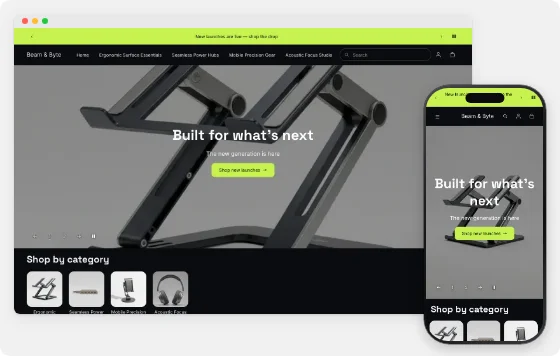
      <br><strong>Volt</strong>
      <br><sub>Best for Electronics · Gadgets · Tools · Car tech</sub>
    </td>
  </tr>
  <tr>
    <td width="25%" valign="top">
      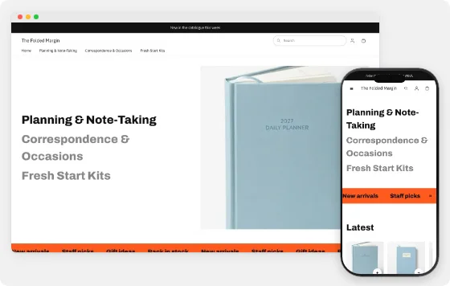
      <br><strong>Studio</strong>
      <br><sub>Best for Cameras · Books &amp; music · Stationery · B2B catalogues</sub>
    </td>
    <td width="25%" valign="top">
      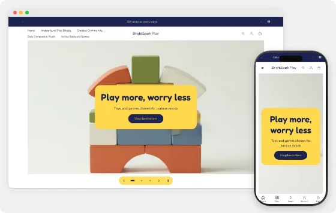
      <br><strong>Play</strong>
      <br><sub>Best for Toys · Kids &amp; baby · Pet toys</sub>
    </td>
    <td width="25%" valign="top">
      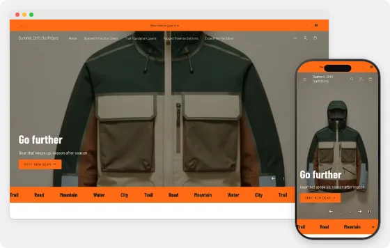
      <br><strong>Trail</strong>
      <br><sub>Best for Sports &amp; outdoors · Bags &amp; luggage · Auto &amp; moto</sub>
    </td>
    <td width="25%" valign="top">
      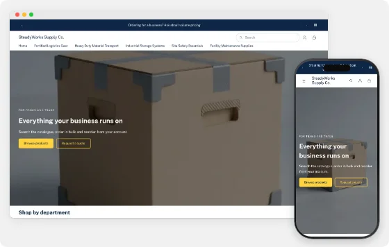
      <br><strong>Pro</strong>
      <br><sub>Best for Business supplies · Hardware · Office · Parts</sub>
    </td>
  </tr>
  <tr>
    <td width="25%" valign="top">
      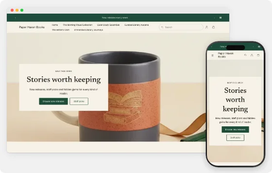
      <br><strong>Shelf</strong>
      <br><sub>Best for Books · Music &amp; film · Games · Digital products</sub>
    </td>
    <td width="25%" valign="top">
      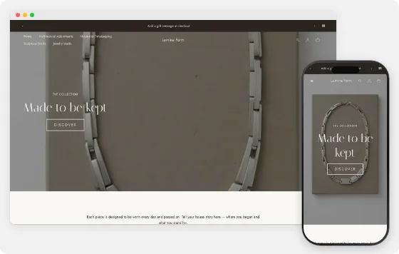
      <br><strong>Luxe</strong>
      <br><sub>Best for Jewellery · Luxury · Home décor · Ceremonial</sub>
    </td>
    <td width="25%" valign="top">
      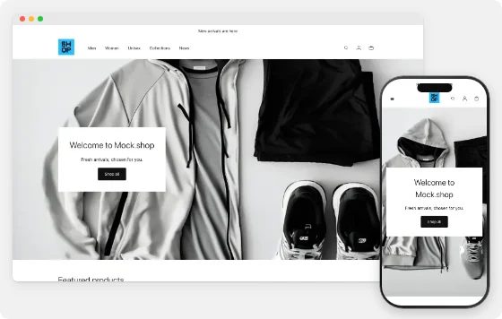
      <br><strong>Default</strong>
      <br><sub>Blank theme: clean, Dawn-like starting point</sub>
    </td>
    <td width="25%" valign="top">
      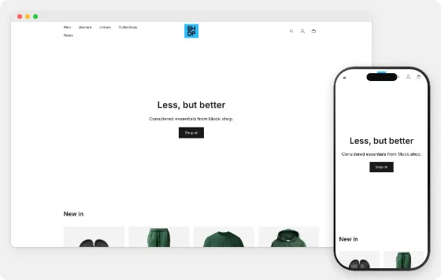
      <br><strong>Minimal</strong>
      <br><sub>Blank theme: monochrome and spacious, with a simple text hero</sub>
    </td>
  </tr>
</table>
<!-- /shared:setup -->

<!-- shared:local-development -->
## Local development

You don't need this to run your store. It's for developers who work on the storefront code.

Requires Node.js 22.12 or later.

```bash
npm install
cp .env.example .env
npm run dev
```

Without store credentials in `.env`, the storefront runs against `mock.shop`, Shopify's public
demo catalog, with the built-in theme. To use your real store, link the storefront and pull its
variables:

```bash
npx shopify hydrogen link       # once per checkout
npx shopify hydrogen env pull   # writes the storefront's variables to .env
npm run dev
```

With a real store, also set `HCMS_API_URL`, `HCMS_PREVIEW_SECRET` and `HCMS_PUBLIC_KEY` in `.env`
(same values as Production). Without them you see the HCMS setup screen instead of the
store.

Customer accounts need trusted local HTTPS: run `npm run dev:https` and open
<https://local.tryhydrogen.dev:5173>.

| Command | Does |
| --- | --- |
| `npm run dev` | Start the local server. |
| `npm run dev:https` | Start the local server with trusted HTTPS (customer accounts). |
| `npm run build` | Production build for Oxygen. |
| `npm run preview` | Build, then run the production build locally. |
| `npm run typecheck` | Type checks and Storefront API query checks. |
| `npm test` | Unit tests. |

Optional variables are described in `.env.example`. `HCMS_INSTALL_URL` changes where the setup
screen's **Install HCMS** button points.
<!-- /shared:local-development -->

## Update the storefront

New sections, blocks and fixes ship as new versions of this template. The HCMS packages
are in `vendor/` and pinned in `package.json`; keep those versions as they are, because each
release is tested against exact versions.

To take an update:

1. Copy `vendor/`, `package.json` and `package-lock.json` from the latest template into your
   repository (or merge the template repository into yours if you track it as a git remote).
   Keep your own files in `app/sections/custom/`.
2. Run `npm install`, `npm run build` and `npm test` locally if you have changed code.
3. Commit and push. Shopify deploys the new version to Oxygen.
4. When the deployment finishes, open HCMS › **Settings › Storefront** and select **Sync**
   on the **Sections** row. The theme editor then shows the new sections.

Your published theme stays live while you update, and you can roll back from **Version history**
in HCMS at any time.

<!-- shared:reference -->
## Custom sections

Developers can add their own sections and blocks to the theme editor. Create
`app/sections/custom/` and put one file per section in it; working examples are in `app/sections/examples/`. Deploy the
storefront, then select **Sync** in HCMS (Settings › Storefront › Sections) and the new sections show up under **Add section**.
No token or extra setup is needed.

Developer tokens, `npx hcms dev` (previewing sections in the editor before you deploy) and `npx hcms push` are
coming in a later version. Until then, deploy, then Sync.

The full guide: [Build your own sections and blocks](./docs/developers/custom-sections.md).

## Custom CSS

Like the Online Store, HCMS has a **Custom CSS** box in Theme settings (whole theme, up to 50 KB) and on every section
(that section only, up to 10 KB). Publishers and admins can edit it; it is rendered on the server, no code deploy needed.
Write it against the stable class names and data attributes we keep across updates (section root
`[data-hcms-section-id]`, block root `[data-hcms-block-id]`, `.hcms-card`, `.hcms-price`, `.hcms-badge`,
`.hcms-button`, `.hcms-header__logo` …); anything else may change. The list and the rules:
[Custom CSS](./docs/developers/custom-css.md).

## Troubleshooting

**Every page shows "This storefront runs on HCMS".** The HCMS variables are missing
from this deployment. Add the variables the screen lists to **Production** (not Preview), then
redeploy. Adding variables doesn't change a running deployment.

**Check connection fails.** Read the message the Setup guide shows under **Check connection**.
Confirm all three variables are in Production and that you redeployed. Make sure the Production
URL opens in your browser. If the environment is private, use **Open and verify**, then
**Refresh**.

**It worked, then stopped after resetting keys.** **Reset keys** in **Settings › Developers ›
Environment variables** creates new values. Update the variables in Shopify and redeploy.

**My changes aren't showing.** Saving doesn't publish. Select **Publish** in the theme editor,
then hard-refresh the storefront. **Version history** shows which version is live.

**New sections are missing from the editor.** Wait for the deployment to finish, then select
**Sync** on the **Sections** row in HCMS › Settings › Storefront.

**The preview is blank in the editor.** Open the preview in a new tab to see whether the
storefront loads on its own, then select **Check now** on **Settings › Storefront › Connection**.
If your storefront can't be shown inside the editor, add an Oxygen shareable link as the
**Preview link** in HCMS › Settings › Storefront.

**HCMS is down.** Your storefront keeps working. It serves the last published theme from
your store's own data, and if that isn't available, the built-in theme. Publishing resumes when
HCMS is back.

For more help, open **Help** in the HCMS app.
<!-- /shared:reference -->

## License

Based on Shopify's Hydrogen template, which is MIT licensed. See [LICENSE](./LICENSE).
